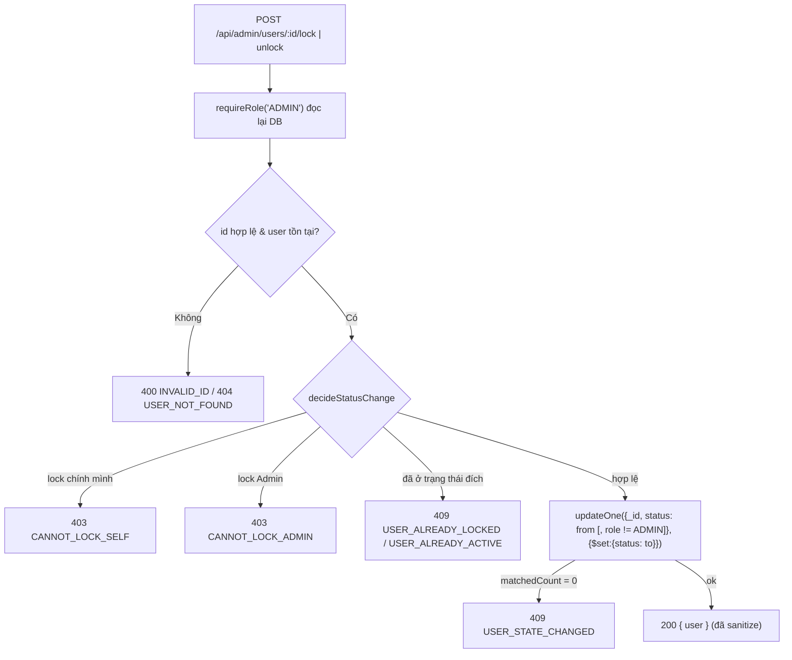

# Quy trình Admin Management & Dashboard (Module 11)

Tìm nhanh khi gặp issue về: khóa/mở khóa user, danh sách/hồ sơ khách, thống kê Dashboard.

| Cần làm gì | Mở file | Hàm / điểm bắt đầu |
| :--- | :--- | :--- |
| Thêm/sửa endpoint `/api/admin/*` | `src/routes/admin.js` | `guard` = `[requireRole('ADMIN'), adminLimit]`, `handle()`, `getDb(req)` |
| Luật Khóa/Mở khóa, hạng & Điểm & Coins | `src/domain/adminUser.js` | `decideStatusChange`, `TRANSITIONS`, `sanitizeUser`, `loyaltyOf`, `tierFilter` |
| Ghi trạng thái user | `src/services/adminService.js` | `setUserStatus` (updateOne nguyên tử theo trạng thái nguồn) |
| Danh sách / hồ sơ / lịch sử khách | `src/services/adminService.js` | `listUsers`, `getUserProfile`, `listUserBookings` |
| Số liệu Dashboard (truy vấn Mongo) | `src/services/adminService.js` | `getDashboard`, `revenueTransactions`, hằng `PAYMENT_TX`, `BOOKING_SNAPSHOT` |
| Công thức Dashboard (thuần) | `src/domain/dashboard.js` | `parseDateRange`, `buildRevenue`, `allocateAmount`, `buildZoneStats`, `rankTopAddons`, `normalizeAddonLine` |
| Mã lỗi | `src/domain/adminError.js` | `AdminError(status, code, message)` → `{ error, message }` |
| Test | `tests/unit/dashboard.test.js`, `tests/unit/adminUser.test.js`, `tests/integration/admin.api.test.js` | `TC-DSH-*`, `TC-ADM-*` |

Mount trong `index.js`: `app.use('/api/admin', require('./src/routes/admin'));` (đặt sau middleware session & `req.body ||= {}`).

---

## 1. Khóa / Mở khóa tài khoản

- Chỉ ghi `status` (validator `users` có `additionalProperties:false`).
- Khóa chỉ áp cho Customer (không khóa Admin) và **không đổi trạng thái các Booking đã có** của khách.
- `BR-A05` (Report): tài khoản `LOCKED` không đăng nhập và không đặt chỗ mới. Cơ chế hiện thực: `requireAuth` đọc lại DB ở mọi request nên session đang đăng nhập bị thu hồi (401) ở request kế tiếp — gồm cả `POST /api/bookings`.

## 1b. Danh sách / hồ sơ khách (UC-29)

`GET /api/admin/users` và `GET /api/admin/users/:id` trả thêm `loyalty { tier, tierName, points, coins }`: `points` = `users.tier_points`, `coins` = `users.coin_balance`, `tier` lấy từ `users.tier` nếu hợp lệ, nếu không thì suy ra từ điểm theo bảng hạng (`TIER_LADDER`, đồng bộ `src/domain/loyalty.js`). Lọc `?tier=` khớp field `tier` hoặc (khi chưa lưu `tier`) khoảng điểm của hạng đó.

## 2. Dashboard — `GET /api/admin/dashboard`

Tham số: `from`, `to` (`YYYY-MM-DD`, giờ VN, gồm cả ngày `to`; mặc định 30 ngày gần nhất, tối đa 366), `zoneId` (`_id` hoặc `zone_code`), `topAddons` (mặc định 5, tối đa 20), `groupBy=day`.

Dashboard có **4 nhóm chỉ số** (Report B.3.30, UC-29, UC-31): số đơn theo 7 trạng thái, Occupancy Rate, Doanh thu, Top Add-on. F&B bán trực tiếp tại quầy (POS) nằm ngoài phạm vi hệ thống nên **không có** trong Dashboard.

Hai mốc thời gian khác nhau:
- Số đơn, Occupancy Rate, Top Add-on: lọc theo **`bookings.start_at`** (ngày sử dụng).
- Doanh thu: lọc theo **thời điểm giao dịch** (`payment_transactions`), không theo `start_at`.

| Chỉ số | Cách tính |
| :--- | :--- |
| Số đơn theo 7 trạng thái | `$group` theo `(space_id, status)`, luôn trả đủ 7 khóa (kể cả 0), cộng lên Zone qua `spaces.zone_id` |
| Doanh thu | Σ `PAYMENT` thành công − Σ `REFUND` thành công, theo thời điểm giao dịch (giờ VN). Không phụ thuộc trạng thái đơn: đơn `CANCELLED` đã hoàn đủ tự bù trừ về 0; hoàn một phần thì doanh thu chỉ giảm đúng số đã hoàn; hoàn tiền `PENDING`/`FAILED` chưa trừ cho đến khi Admin đối soát (`refund-reconcile` ghi thêm `REFUND` thành công). Kỳ chỉ có hoàn tiền cho ra số âm (không chặn ở 0) |
| Phân rã doanh thu | `revenue.breakdown { package, inclusionSurcharge, addon, discount }`; `package + inclusionSurcharge + addon − discount = revenue.total`. Mỗi giao dịch chia theo Price Snapshot của Booking theo tỷ lệ `amount / final_amount` (`allocateAmount`); Inclusion, Add-on, Giảm giá (voucher + hạng) làm tròn VND, Package là phần còn lại |
| Occupancy Rate (%) | Σ giờ-không-gian đã dùng ÷ Σ (số ngày × giờ mở cửa) của các space. `EXCLUSIVE`: giờ đặt. `SHARED`: giờ-khách ÷ `capacity`. Chỉ tính 4 trạng thái chiếm chỗ; mẫu số gồm space `ACTIVE` hoặc space có giờ dùng trong kỳ; thời lượng được cắt ở cuối kỳ |
| Top Add-on | `bookings` (4 trạng thái doanh thu) → `$lookup booking_addons` → gom theo `addon_id`; xếp theo số lượng, hòa thì doanh thu, rồi tên |
| Doanh thu theo ngày (`groupBy=day`) | `daily[] { date, revenue, payment, refund }` gom theo ngày giao dịch (giờ VN); ngày không có giao dịch không xuất hiện |
| Lọc Zone với doanh thu | Giao dịch → `bookings.space_id` → `spaces.zone_id`; giao dịch của Booking ngoài Zone bị bỏ |

Kết quả: `{ range, filters, bookings, occupancy, revenue:{basis,total,breakdown,collected,refunded}, topAddons, zones[], daily? }`. Mỗi phần tử `zones[]` có `revenue { total, breakdown }`.

## 3. Chạy thử trên Mongo thật (chưa làm trong phiên này)

1. Đăng nhập Admin, gọi `GET /api/admin/dashboard` và đối chiếu: `bookings.total` = số đơn có `start_at` trong kỳ; `revenue.total` = Σ `PAYMENT` SUCCESS − Σ `REFUND` SUCCESS có thời điểm giao dịch trong kỳ.
2. Kiểm tra tên field thật trong `payment_transactions.validator.json`, `bookings` (Price Snapshot) và `booking_addons.validator.json`; sửa `PAYMENT_TX` / `BOOKING_SNAPSHOT` / `normalizeAddonLine` nếu khác.
3. Khóa 1 khách → khách đó gọi `GET /api/me` và `POST /api/bookings` phải bị 401 (BR-A05), đơn mới không được tạo.
