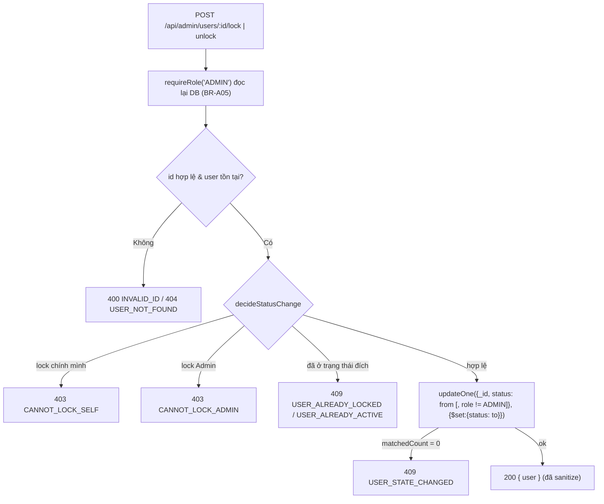

# Quy trình Admin Management & Dashboard (Module 11)

Tìm nhanh khi gặp issue về: khóa/mở khóa user, danh sách/hồ sơ khách, thống kê Dashboard.

| Cần làm gì | Mở file | Hàm / điểm bắt đầu |
| :--- | :--- | :--- |
| Thêm/sửa endpoint `/api/admin/*` | `src/routes/admin.js` | `guard` = `[requireRole('ADMIN'), adminLimit]`, `handle()`, `getDb(req)` |
| Luật Khóa/Mở khóa | `src/domain/adminUser.js` | `decideStatusChange`, `TRANSITIONS`, `sanitizeUser` |
| Ghi trạng thái user | `src/services/adminService.js` | `setUserStatus` (updateOne nguyên tử theo trạng thái nguồn) |
| Danh sách / hồ sơ / lịch sử khách | `src/services/adminService.js` | `listUsers`, `getUserProfile`, `listUserBookings` |
| Số liệu Dashboard (truy vấn Mongo) | `src/services/adminService.js` | `getDashboard`, `fnbDirectRevenue`, `dailySeries`, hằng `FNB` |
| Công thức Dashboard (thuần) | `src/domain/dashboard.js` | `parseDateRange`, `buildZoneStats`, `rankTopAddons`, `normalizeAddonLine` |
| Mã lỗi | `src/domain/adminError.js` | `AdminError(status, code, message)` → `{ error, message }` |
| Test | `tests/unit/dashboard.test.js`, `tests/unit/adminUser.test.js`, `tests/integration/admin.api.test.js` | `TC-DSH-*`, `TC-ADM-*` |

Mount trong `index.js`: `app.use('/api/admin', require('./src/routes/admin'));` (đặt sau middleware session & `req.body ||= {}`).

---

## 1. Khóa / Mở khóa tài khoản

- Chỉ ghi `status` (validator `users` có `additionalProperties:false`).
- Session đang đăng nhập của user bị khóa bị thu hồi ở request kế tiếp vì `requireAuth` đọc lại DB.

## 2. Dashboard — `GET /api/admin/dashboard`

Tham số: `from`, `to` (`YYYY-MM-DD`, giờ VN, gồm cả ngày `to`; mặc định 30 ngày gần nhất, tối đa 366), `zoneId` (`_id` hoặc `zone_code`), `topAddons` (mặc định 5, tối đa 20), `groupBy=day`.

Mốc thời gian lọc đơn: **`bookings.start_at`** (ngày sử dụng).

| Chỉ số | Cách tính |
| :--- | :--- |
| Số đơn theo 7 trạng thái | `$group` theo `(space_id, status)`, luôn trả đủ 7 khóa (kể cả 0), cộng lên Zone qua `spaces.zone_id` |
| Doanh thu thực tế | Tổng `bookings.final_amount` (Price Snapshot) của `CONFIRMED`, `CHECKED_IN`, `CHECKED_OUT`, `NO_SHOW` |
| Occupancy Rate (%) | Σ giờ-không-gian đã dùng ÷ Σ (số ngày × giờ mở cửa) của các space. `EXCLUSIVE`: giờ đặt. `SHARED`: giờ-khách ÷ `capacity`. Chỉ tính 4 trạng thái chiếm chỗ; mẫu số gồm space `ACTIVE` hoặc space có giờ dùng trong kỳ; thời lượng được cắt ở cuối kỳ |
| Top Add-on | `bookings` (4 trạng thái doanh thu) → `$lookup booking_addons` → gom theo `addon_id`; xếp theo số lượng, hòa thì doanh thu, rồi tên |
| Doanh thu F&B trực tiếp | `$group` tổng tiền trên `sales_transactions` trong kỳ (không gắn Zone → `scope: ALL_ZONES`, không đổi khi lọc `zoneId`) |
| `revenue.grandTotal` | Doanh thu đơn đặt chỗ + F&B trực tiếp |

Kết quả: `{ range, filters, bookings, occupancy, revenue:{bookings,fnbDirect,grandTotal}, topAddons, zones[], daily? }`.

## 3. Chạy thử trên Mongo thật (chưa làm trong phiên này)

1. Đăng nhập Admin, gọi `GET /api/admin/dashboard` và đối chiếu: tổng `bookings.total` = số đơn có `start_at` trong kỳ; `revenue.bookings.total` = tổng `final_amount` 4 trạng thái.
2. Kiểm tra tên field thật trong `booking_addons.validator.json` và `sales_transactions.validator.json`; sửa `FNB` / `normalizeAddonLine` nếu khác.
3. Khóa 1 khách → khách đó gọi `GET /api/me` phải bị 401 (BR-A05).
