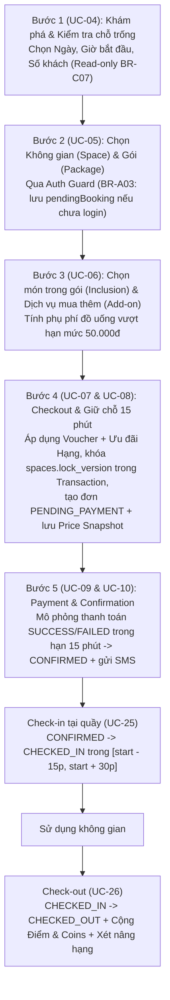

# Quy trình Đặt không gian 5 bước (`BR-D01`), Vận hành & Chống đặt trùng

Tài liệu mô tả chi tiết luồng xử lý đặt không gian (Module quan trọng nhất của hệ thống KÉN) được cài đặt tại:
- [`src/services/bookingService.js`](../../src/services/bookingService.js)
- [`src/routes/catalog.js`](../../src/routes/catalog.js)
- [`src/routes/bookings.js`](../../src/routes/bookings.js)
- [`src/domain/availability.js`](../../src/domain/availability.js)
- [`src/domain/bookingStateMachine.js`](../../src/domain/bookingStateMachine.js)
- [`src/domain/pricing.js`](../../src/domain/pricing.js)
- [`test/booking.test.js`](../../test/booking.test.js)

---

## 1. Sơ đồ tổng thể quy trình chuẩn `BR-D01`

---

## 2. Chi tiết 5 bước Đặt chỗ

### Bước 1: Khám phá & Kiểm tra chỗ trống (`UC-04`, `BR-C07`)
- **API:** `GET /api/spaces?startAt=...&guestCount=...&hours=...&zoneId=...` hoặc `POST /api/availability` (không truyền `spaceId`).
- **Hàm xử lý:** `searchAvailableSpaces(db, query)` trong `bookingService.js`.
- **Quy tắc nghiệp vụ:**
  - Chế độ **Read-only (`BR-C07`)**: Không tạo bản ghi giữ chỗ trong DB, cho phép nhiều người dùng tra cứu đồng thời.
  - Tự động đối chiếu giờ mở cửa (`open_time` – `close_time` theo giờ Việt Nam `UTC+7`), sức chứa (`min_guests <= guestCount <= max_guests <= capacity`), và các đơn đang chiếm chỗ (`PENDING_PAYMENT` còn hạn, `CONFIRMED`, `CHECKED_IN`).
  - Trả về danh sách từng không gian kèm `isAvailable`, `remainingCapacity`, `minPackagePrice` và danh sách `compatiblePackages` khả dụng cho khung giờ đó.

### Bước 2: Chọn Không gian (Space) & Gói dịch vụ (Package) (`UC-05`, `BR-A03`)
- **API:** `POST /api/bookings/select-package`
- **Hàm xử lý:** `selectSpaceAndPackage(db, payload)` + Session Auth Guard trong `src/routes/bookings.js`.
- **Quy tắc nghiệp vụ:**
  - **Auth Guard (`BR-A03`):** Nếu khách chưa đăng nhập (`Guest`), hệ thống lưu toàn bộ lựa chọn (`spaceId`, `packageId`, `startAt`, `hours`, `guestCount`) vào `req.session.pendingBooking` và trả về `401 AUTH_GUARD_REQUIRED`. Ngay sau khi khách đăng nhập (`POST /api/login` hoặc `POST /api/login/2fa`), `startSession` bảo toàn `pendingBooking` và trả về trong response để Frontend đưa khách quay lại đúng bước đang đặt dở.
  - Kiểm tra gói dịch vụ có thuộc bảng giá `package_prices` của Space đã chọn hay không (`PACKAGE_INCOMPATIBLE`).
  - Xác định khung giờ thực tế `resolveTimeWindow`:
    - Gói `FIXED` có `duration_hours` (예: 4 giờ) → `end_at = start_at + duration_hours`.
    - Gói `FIXED` có `is_full_day = true` (Gói Cả ngày) → `end_at = close_time` (22:00).
    - Gói `HOURLY` → `end_at = start_at + hours` (kiểm tra `hours >= min_hours`).
    - Thời điểm bắt đầu phải cách hiện tại tối thiểu **30 phút** (`MIN_LEAD_MINUTES = 30`, `BR-C01`).

### Bước 3: Chọn món trong gói (Inclusion) & Dịch vụ mua thêm (Add-on) (`UC-06`, `BR-B03`)
- **API:** `POST /api/bookings/quote`
- **Hàm xử lý:** `computeCheckoutPreview(db, payload)` trong `bookingService.js`.
- **Quy tắc nghiệp vụ:**
  - **Quyền lợi tự động (`fixed_inclusions_snapshot`):**
    - Nước lọc miễn phí (`WATER`): tự động cấp theo số khách khi thời lượng đặt `>= min_hours_required` (ví dụ từ 2 giờ trở lên).
    - Thiết bị đi kèm gói (`EQUIPMENT`): tự động ghi nhận vào snapshot của đơn.
  - **Chọn đồ uống & bánh đi kèm gói (`booking_inclusions`):**
    - Đối với `STANDARD_DRINK` có hạn mức hỗ trợ `subsidy_limit = 50.000đ`: nếu khách chọn món có đơn giá $> 50.000\text{đ}$ (ví dụ Kombucha 59.000đ), hệ thống chỉ thu phần chênh lệch:
      $$\text{surcharge\_amount} = \max(0, \text{unit\_price} - 50.000) \times \text{quantity}$$
    - Kiểm tra tổng số lượng món chọn không vượt quá định mức của gói (`INCLUSION_QUOTA_EXCEEDED`, `PER_GUEST` hoặc `PER_BOOKING`).
  - **Dịch vụ mua thêm (`booking_addons`):**
    - Hỗ trợ chọn biến thể (`variants`), kiểm tra quy tắc `PER_BOOKING` chỉ cho phép `quantity = 1`.

### Bước 4: Checkout — Áp dụng Ưu đãi & Tạo đơn giữ chỗ 15 phút (`UC-07`, `UC-08`, `BR-B03`, `BR-D02`)
- **API:** `POST /api/bookings`
- **Hàm xử lý:** `checkoutBooking(db, payload)` trong `bookingService.js`.
- **Quy tắc nghiệp vụ:**
  - **Never Trust the Client:** Mọi con số tiền tệ đều được tính lại tại Backend qua `calculatePricing` (`src/domain/pricing.js`):
    1. $\text{subtotal} = \text{package\_price} + \text{inclusion\_surcharge} + \text{addon\_total}$
    2. Trừ `voucher_discount` trước (kiểm tra `status = ACTIVE`, hạn dùng, `min_order_value`, `usage_count < usage_limit`, và kiểm tra ví `user_vouchers` nếu là Voucher đổi bằng Coins).
    3. Tính `tier_discount` trên phần còn lại sau Voucher, làm tròn xuống (`Math.floor`).
    4. $\text{final\_amount} = \text{subtotal} - (\text{voucher\_discount} + \text{tier\_discount})$.
  - **Chống đặt trùng song song trong ACID Transaction:**
    1. Bắt đầu `session.withTransaction()`.
    2. Thực hiện `updateOne({ _id: space._id, status: 'ACTIVE' }, { $inc: { lock_version: 1 } })` để lấy khóa ghi (write lock) trên document `spaces`. Nếu 2 request chạy song song cùng đặt 1 Space, MongoDB sẽ phát hiện xung đột ghi (`WriteConflict` code 112), tự động tuần tự hóa và chạy lại transaction thứ 2 sau khi transaction thứ 1 đã commit.
    3. Chạy `evaluateSpaceAvailability` ngay bên trong transaction:
       - Với `EXCLUSIVE`: chặn nếu có bất kỳ đơn nào giao nhau trên khoảng `[start_at, end_at + buffer_minutes]` (Buffer 15 phút dọn phòng).
       - Với `SHARED`: tính tổng `guest_count` của mọi cặp thời gian giao nhau tại từng mốc sự kiện, chặn nếu vượt `capacity`.
    4. Giữ lượt Voucher (`$inc: { usage_count: 1 }`) và đánh dấu `user_vouchers.used_booking_id` nếu dùng Voucher từ ví Coins.
    5. Ghi đóng băng toàn bộ báo giá vào `bookings`, `booking_inclusions`, `booking_addons` với hạn thanh toán `payment_expires_at = created_at + 15 phút`.

### Bước 5: Payment & Confirmation (`UC-09`, `UC-10`, `BR-E01..E03`)
- **API:** `POST /api/bookings/:id/pay` (hoặc `POST /api/payments`)
- **Hàm xử lý:** `processBookingPayment(db, { bookingId, user, result, now })`.
- **Quy tắc nghiệp vụ:**
  - Nếu `result = 'FAILED'`: ghi nhận 1 bản ghi `payment_transactions` trạng thái `FAILED`, giữ nguyên đơn ở `PENDING_PAYMENT` và **không reset** `payment_expires_at` để khách có thể thử thanh toán lại trong thời gian còn lại.
  - Nếu `result = 'SUCCESS'` (và `now < payment_expires_at`): chuyển đơn sang `CONFIRMED`, ghi `payment_transactions` trạng thái `SUCCESS` và gửi SMS xác nhận kèm mã đặt chỗ `booking_code`.

---

## 3. Hủy đơn, Đổi giờ & Vận hành tại quầy

| Nghiệp vụ | API | Quy tắc cốt lõi |
| :--- | :--- | :--- |
| **Hủy đơn chờ (`UC-11`, `BR-D04`)** | `POST /api/bookings/:id/cancel` | Khách hủy khi đơn đang `PENDING_PAYMENT` và còn hạn giữ chỗ → chuyển `CANCELLED`, hoàn trả lượt Voucher (`voucher_usage_released = true`), `refund_status = NONE`. |
| **Hủy đơn đã xác nhận (`UC-12`, `UC-14`, `BR-G01`)** | `POST /api/bookings/:id/cancel` | Chỉ được hủy trước giờ bắt đầu tối thiểu **120 phút** (`CANCEL_CUTOFF_MINUTES = 120`). Tự động hoàn trả lượt Voucher và mô phỏng hoàn tiền (`REFUNDED` hoặc `FAILED` nếu cổng thanh toán lỗi). |
| **Đổi giờ đặt chỗ (`UC-13`, `UC-15`, `BR-G03`)** | `POST /api/bookings/:id/reschedule` | Chỉ áp dụng cho đơn `CONFIRMED` trước Cut-off Time 120 phút; giờ mới phải cách hiện tại $\ge 30$ phút, giữ nguyên Space/Package/thời lượng và kiểm tra chống trùng trong Transaction có khóa `lock_version`. |
| **Check-in (`UC-25`, `BR-F01`)** | `POST /api/bookings/:id/check-in` | Admin thực hiện trong cửa sổ `[start_at - 15 phút, start_at + 30 phút]`. Chuyển `CONFIRMED → CHECKED_IN`. |
| **Check-out (`UC-26`, `BR-H03`, `BR-H04`)** | `POST /api/bookings/:id/check-out` | Admin thực hiện khi khách trả chỗ: chuyển `CHECKED_IN → CHECKED_OUT`, tự động tính Điểm & Coins ($\lfloor \text{final\_amount} / 10.000 \rfloor$), xét nâng hạng tức thì và ghi `loyalty_transactions` trong cùng Transaction. |
| **No-show (`UC-27`, `BR-F02`)** | `POST /api/bookings/:id/no-show` | Admin đánh dấu `CONFIRMED → NO_SHOW` khi khách không đến sau `start_at + 30 phút` (`NO_SHOW_GRACE_MINUTES = 30`). Không hoàn tiền, không tích điểm. |
| **Đối soát hoàn tiền (`UC-28`)** | `POST /api/bookings/:id/refund-reconcile` | Admin xử lý thủ công các đơn `CANCELLED` có `refund_status = FAILED` → chuyển sang `MANUALLY_RESOLVED` và ghi giao dịch `REFUND` (`method: MANUAL`). |
| **Thu hồi giữ chỗ quá hạn (`UC-36`, `BR-E03`)** | Cron 1 phút / `POST /api/bookings/expire-holds` | Tự động chuyển các đơn `PENDING_PAYMENT` có `payment_expires_at <= now` sang `EXPIRED` và hoàn trả lượt Voucher để giải phóng chỗ trống. |
