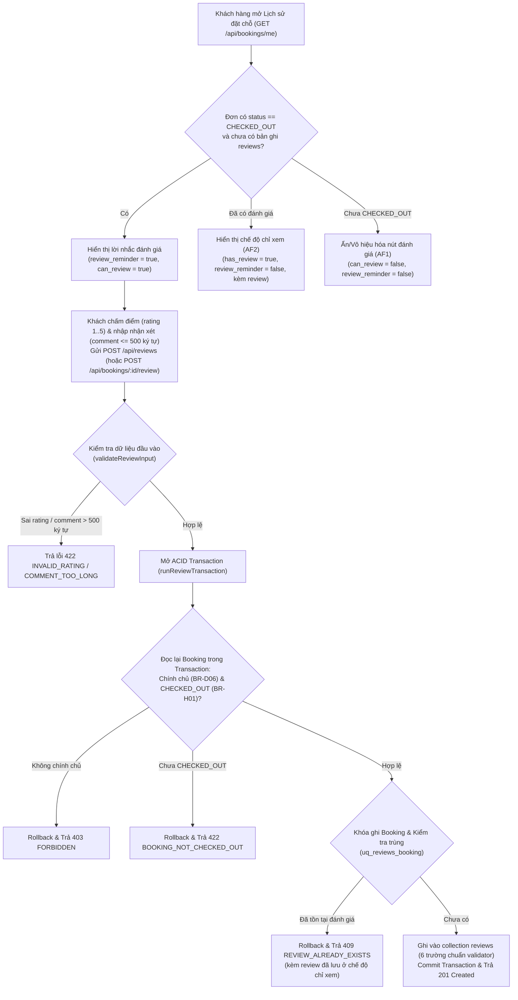

# Quy trình Quản lý Đánh giá sau sử dụng (`Review Management` — Module 10, `UC-16`, `BR-H01`, `FR-4.3`)

Tài liệu mô tả chi tiết luồng xử lý của phân hệ **Review Management** được cài đặt tại:
- [`src/domain/review.js`](../../src/domain/review.js)
- [`src/services/reviewService.js`](../../src/services/reviewService.js)
- [`src/routes/reviews.js`](../../src/routes/reviews.js)
- [`src/routes/bookings.js`](../../src/routes/bookings.js) (`GET /api/bookings/me`, `GET /api/bookings/:id`, `GET / POST /api/bookings/:id/review`)
- [`src/routes/catalog.js`](../../src/routes/catalog.js) (`GET /api/spaces/:id/reviews`)
- [`test/review.test.js`](../../test/review.test.js)

---

## 1. Sơ đồ quy trình nghiệp vụ (`UC-16` & `BR-H01`)

---

## 2. Bốn quy tắc cốt lõi đã hiện thực hóa

### 2.1. Kiểm tra điều kiện đơn chính chủ và đã `CHECKED_OUT` (`BR-D06`, `BR-H01`, `BR-F03`, `NFR-02`)
- **Kiểm tra chính chủ (`BR-D06`):** So sánh `String(booking.user_id) === String(req.user._id)`. Nếu người dùng cố tình gửi `bookingId` của khách hàng khác, hệ thống từ chối với mã `403 FORBIDDEN`.
- **Kiểm tra trạng thái `CHECKED_OUT` (`BR-H01`, `BR-F03`):** Chỉ những đơn đã được Admin xác nhận `CHECKED_OUT` mới đủ điều kiện đánh giá. Mọi trạng thái khác (`PENDING_PAYMENT`, `CONFIRMED`, `CHECKED_IN`, `NO_SHOW`, `CANCELLED`, `EXPIRED`) đều bị chặn với mã `422 BOOKING_NOT_CHECKED_OUT`.
- **Kiểm tra lại trong Transaction (`NFR-02`):** Không phụ thuộc vào trạng thái lúc hiển thị form trên giao diện; khi thực thi `createReview`, Backend mở Transaction đọc lại `bookings` và kiểm tra lại toàn bộ điều kiện trước khi ghi.

### 2.2. Chặn đánh giá trùng — Tối đa 01 đánh giá / Booking (`BR-H01`, `EX-5.6`)
- Hệ thống bảo vệ ở **2 lớp**:
  1. **Lớp Transaction & Khóa ghi (`Write Lock`):** Trong Transaction lưu đánh giá, hệ thống lấy khóa ghi trên bản ghi `bookings` (`updateOne({ _id: bOid, user_id: user._id, status: 'CHECKED_OUT' })`), sau đó kiểm tra `reviews.findOne({ booking_id: bOid })`. Nếu 2 request gửi đồng thời từ 2 tab/thiết bị (`EX-5.6`), MongoDB phát hiện `WriteConflict` (code `112`), tuần tự hóa request thứ 2 và trả về `409 REVIEW_ALREADY_EXISTS` kèm bản ghi `review` đã lưu.
  2. **Lớp Cơ sở dữ liệu (`uq_reviews_booking`):** Unique index `{ booking_id: 1 }` trên collection `reviews` đảm bảo tuyệt đối mỗi Booking chỉ có tối đa 01 bản ghi đánh giá.

### 2.3. Tạo và Xem đánh giá (`FR-4.3`, `reviews.validator.json`)
- **Tuân thủ `reviews.validator.json` (`additionalProperties: false`):**
  - `_id`: `ObjectId`
  - `booking_id`: `ObjectId` (FK $\rightarrow$ `bookings._id`, `UNIQUE`)
  - `user_id`: `ObjectId` (FK $\rightarrow$ `users._id`)
  - `rating`: `int` bắt buộc từ `1` đến `5` (`REVIEW_MIN_RATING = 1`, `REVIEW_MAX_RATING = 5`)
  - `comment`: `string | null`, tự động `.trim()`, tối đa `500` ký tự (`REVIEW_MAX_COMMENT_LENGTH = 500`)
  - `created_at`: `Date` (đảm bảo `created_at >= booking.checked_out_at`)
- **Các chế độ xem đánh giá:**
  - **Theo Booking (`GET /api/reviews/booking/:bookingId` hoặc `GET /api/bookings/:id/review`):** Trả về trạng thái đủ điều kiện (`canReview`, `hasReview`, `reviewReminder`) và nội dung đánh giá đã gửi (chế độ chỉ xem theo `AF2`).
  - **Theo Không gian (`GET /api/reviews/space/:spaceId` hoặc `GET /api/spaces/:id/reviews`):** Truy vết qua các đơn `CHECKED_OUT` của Space để trả về danh sách đánh giá kèm điểm trung bình (`averageRating`), tổng số đánh giá (`totalReviews`) và phân bố số sao (`ratingDistribution` từ 1 đến 5 sao).
  - **Theo Khách hàng (`GET /api/reviews/me`):** Trả về danh sách các đánh giá khách đã gửi kèm danh sách các đơn `CHECKED_OUT` đang chờ đánh giá (`pendingReminders`).

### 2.4. Hiển thị lời nhắc đánh giá trong lịch sử đặt chỗ (`GET /api/bookings/me`, `GET /api/bookings/:id`)
- Khi khách hàng mở **Lịch sử đặt chỗ (`GET /api/bookings/me`)**, hàm `attachReviewsToBookings` đối chiếu danh sách đơn với bảng `reviews` và gắn trực tiếp vào từng đơn:
  - `has_review` (`hasReview`): `true` nếu đơn đã có đánh giá, `false` nếu chưa.
  - `can_review` (`canReview`): `true` nếu `status === 'CHECKED_OUT' && !has_review`.
  - `review_reminder` (`reviewReminder`): `true` khi đơn đã `CHECKED_OUT` nhưng chưa có đánh giá $\rightarrow$ giao diện hiển thị lời nhắc *"Đánh giá trải nghiệm của bạn"*. Ngay sau khi khách gửi đánh giá thành công, cờ `review_reminder` tự động chuyển về `false` và trường `review` trả kèm dữ liệu đánh giá để hiển thị ở chế độ chỉ xem.
